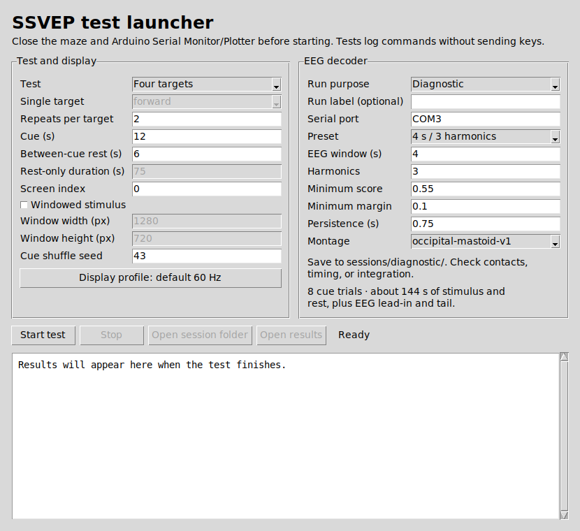

# SSVEP Decoding

Decode visual target selection from four EEG channels using canonical correlation analysis (CCA). The test launcher coordinates the MG24 stream and a PsychoPy stimulus in one run. It logs command decisions for review.

## Run a test



Use a Python 3.10+ environment with Tk and run these commands from the decoder repository root. Run `python -m tkinter` to check that Tk is available. [Python Tk documentation](https://docs.python.org/3/library/tkinter.html)

**Windows (PowerShell)**

```powershell
python -m pip install -e ".[stimulus]"
.\run-tests.cmd
```

The Windows batch file checks `SSVEP_DECODER_PYTHON`, `.venv`, the Conda environment named `venv`, then Python on `PATH`. Run `python -m ssvep_decoding.launcher` to use the active Python environment directly.

**macOS and Linux (terminal)**

```bash
python -m pip install -e ".[stimulus]"
python -m ssvep_decoding.launcher
```

Use `python3` if that is the command for your Python environment. **Rest only** works with the base install (`python -m pip install -e .`) on all three platforms.

1. Upload the MG24 EEG streamer and close the maze and Arduino Serial Monitor or Plotter. Enter the serial port in the launcher. The default `COM3` is a Windows example. Run `python -m serial.tools.list_ports` to find the port on your system. [pySerial port listing](https://pyserial.readthedocs.io/en/latest/tools.html#serial-tools-list-ports)
2. Choose **Single target**, **Four targets**, or **Rest only**. Set the run purpose and an optional label such as `contact-check`. Confirm the [montage](docs/montages.md).
3. Choose a decoder preset, such as **4 s / 3 harmonics** or **2 s / 2 harmonics**. Adjust timing, thresholds, repeats, and the display profile as needed.
4. Click **Start test**. After the run, review the summary and use **Open session folder** for the original recording or **Open results** for the report. **Stop** or **Escape** in PsychoPy ends the run and saves available data.

Use **Diagnostic** for troubleshooting, **Development** for tuning, and **Evaluation** for fresh recordings under a fixed protocol. [Recording protocols](docs/protocols.md)

## Recordings and results

| Path | Contents |
|---|---|
| `sessions/<purpose>/<source-id>/` | Original EEG, stimulus markers, resolved profiles, montage, and process logs |
| `results/<source-id>/live/` | Live summary in text and JSON |
| `results/<source-id>/replays/<replay-id>/` | Replay decisions, resolved profiles, source reference, and summary |

Recordings and generated results stay local by default. New launcher session names include their intent, test, decoder window, harmonic count, timestamp, and optional label. Replay names include their decoder window, harmonic count, timestamp, and optional label. [Session catalog](docs/results/session-catalog.md) · [Historical Round 1 report](docs/results/2026-10-16-round-01.md)

## Command line

The live example uses a Windows serial port. On macOS or Linux, pass the device path from the port listing to `--port`. Optional keyboard output is Windows-only.

```powershell
python -m ssvep_decoding synthetic --target forward --seconds 10
python -m ssvep_decoding live --port COM3 --seconds 60 --montage occipital-mastoid-v1
python -m ssvep_decoding replay --input sessions/<source-id>/raw.csv --label baseline
```

For launcher recordings, pass `sessions/<purpose>/<source-id>/decoder/raw.csv` to replay. Use the [command-line guide](docs/command-line.md) for manual PsychoPy runs, profile overrides, and optional keyboard output.

## Related repositories

- **ssvep-acquisition** runs upstream of the decoder. Its MG24 firmware streams four timestamped EEG channels over serial. The decoder reads that stream live or replays its recorded CSV and metadata. The acquisition repo also contains the BPW34 photodiode tools for checking the actual flicker frequencies used by the decoder. [Acquisition firmware and tools](https://github.com/neurocontrol-lab/ssvep-acquisition)
- **ssvep-navigation-ui** provides the OpenGL maze and its four directional flicker targets. For maze runs, the decoder uses a stimulus profile that matches the maze, then sends scores and accepted actions over local UDP. Use `--maze-hud` to view scores or `--maze-control` to enable EEG steering. The PsychoPy launcher above runs standalone tests and logs decisions. [Maze integration guide](https://github.com/neurocontrol-lab/ssvep-navigation-ui#readme)
